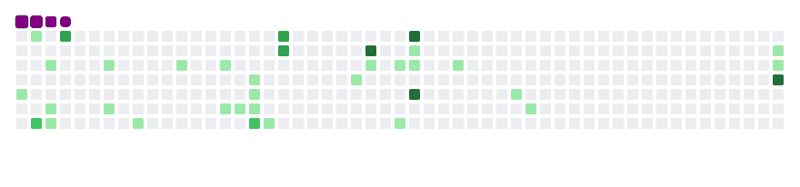

<p align = "center">
  
  <!--  -->
</p>

## Hi There 👋, Here's a Little About Me &nbsp;&nbsp;&nbsp; 
```c++
struct { // About Me
    string intro = "Hi, I'm Parth, a software developer.";
    vector<string> common_langs = { "HTML", "Python", "C", "C++", "SQL"};
    vector<string> learning = { "CSS", "Javascript" , "EthicalHacking" };
    string interest = "I love Music, Video games, Manga and Anime";
    string email = "parthworks247+github@gmail.com";
    string discord = "@ParthProLegend";
    string matrix = "@parthprolegend:matrix.org"; //Getting reply here is nearly impossible
} Parth;
```

<!--    -->
---
## Current Status:

<!-- [](https://open.spotify.com/user/mocwilcox) -->
I stopped watching anime and reading manga, mitigated doomscrolling and listening to music. Focusing on health, diet and skills.

## My stats:


<div style="display: flex; justify-content: center; align-items: center; flex-wrap: wrap;">
  
  <div style="margin-right: 25;">
    
  </div>
</div>

 ## Skills
<div style="display: inline-block;">  <!-- <div style="display: flex; flex-direction: row;"> -->

  

  <!--
  
  <br>
  
 &nbsp;&nbsp;&nbsp;&nbsp;&nbsp;&nbsp;&nbsp;&nbsp;&nbsp;&nbsp;&nbsp;
  
 &nbsp;&nbsp;&nbsp;&nbsp;&nbsp;&nbsp;&nbsp;&nbsp;&nbsp;&nbsp;&nbsp;
  
 &nbsp;&nbsp;&nbsp;&nbsp;&nbsp;&nbsp;&nbsp;&nbsp;&nbsp;&nbsp;&nbsp;
  
 &nbsp;&nbsp;&nbsp;&nbsp;&nbsp;&nbsp;&nbsp;&nbsp;&nbsp;&nbsp;&nbsp;
  
 &nbsp;&nbsp;&nbsp;&nbsp;&nbsp;&nbsp;&nbsp;&nbsp;&nbsp;&nbsp;&nbsp;
  

  -->
  <br><br><br><br><br><br><br><br><br>
</div>

<!--

 <div style="display: flex; align-items: center; gap: 50; flex-wrap: wrap;">
  
  
  
  
  
  
  
</div>

<br><br><br><br><br>
-->

## Contact
<div>
  <a href="https://www.linkedin.com/in/ParthProLegend" target="_blank"></a>
  <a href="https://twitter.com/ParthProLegend" target="_blank"></a>
  <a href="https://instagram.com/ParthProLegend" target="_blank"></a>
  <a href = "mailto:parthworks247+github@gmail.com"></a>
</div>
 <!-- Github workflow  -->

---

<p align="center">
  <picture>
    <source media="(prefers-color-scheme: dark)" srcset="https://raw.githubusercontent.com/ParthProLegend/ParthProLegend/refs/heads/snake_gif/github-contribution-grid-snake-dark.svg">
    <source media="(prefers-color-scheme: light)" srcset="https://raw.githubusercontent.com/ParthProLegend/ParthProLegend/refs/heads/snake_gif/github-contribution-grid-snake-light.svg">
    
  </picture>
</p>


<!--  -->
